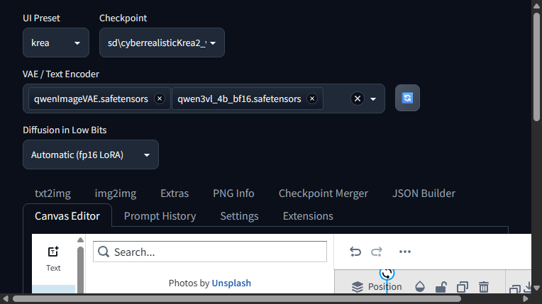

# Stable Diffusion WebUI Canvas Editor (Forge Neo fork)

> A Polotno-based canvas editor tab for **Stable Diffusion Forge Neo** — compose images, layers, text and elements, then send the result to img2img / inpaint / ControlNet (or pull your generated images back into the canvas as a library).

This is a fork of [jtydhr88/sd-canvas-editor](https://github.com/jtydhr88/sd-canvas-editor) (thanks @jtydhr88 for the original work!), ported and fixed for **Stable Diffusion Forge Neo** (Gradio 4.x).

## Why this fork?

The original extension breaks on modern Gradio 4.x (used by Forge Neo) for two reasons:

1. **It doesn't even load** — `scripts/main.py` annotates its helpers with `gr.components.IOComponent`, an internal Gradio 3.x class that no longer exists. The whole script dies at import, so the *Canvas Editor* tab never appears.
2. **Its UI hooks target Gradio 3 DOM** — Forge Neo replaces the img2img/inpaint image boxes (and the ControlNet unit image inputs) with its own canvas widget, and Gradio 4 renders tabs differently, so the "Send to …" buttons would crash or silently no-op.

This fork:

1. Replaces the Gradio 3-only type annotation with a lazy `'gr.components.Component'` annotation, so the tab registers on Gradio 3 *and* Gradio 4.
2. Makes the image injection work on **both** worlds:
   - standard Gradio image components (`div[data-testid="image"]` + `Clear` button) — original A1111 behavior kept;
   - Forge's custom canvas widget (`.forge-container`, `imageInput_<uuid>` / `removeButton_<uuid>`).
3. Targets Forge's ControlNet unit image blocks by their deterministic ids (`<tab>_controlnet_ControlNet-<n>_input_image`), with the original accordion-scan logic kept as fallback.
4. Switches to the Canvas Editor tab via the tab button's `aria-controls` attribute (position-based math kept as fallback for older Gradio).
5. Wires the "Send to Canvas Editor" gallery buttons to the gallery components by DOM id (`#txt2img_gallery`, …), which the upstream `window.*_gallery` globals never actually provided.

Tested on Forge Neo (branch `neo`, Gradio 4.40, Python 3.13): tab renders, Polotno canvas works, and all send-to flows (img2img, inpaint, ControlNet unit, gallery → canvas) verified live.

**Known limitation (upstream, not forge-specific):** the Polotno *Photos* panel's Unsplash stock grid fails to load ("Loading is failed..."). Everything else in the editor works; upload your own images via *Upload* or use the local *Txt2img* / *Img2img* library panels.

## Original README
A custom extension for [AUTOMATIC1111/stable-diffusion-webui](https://github.com/AUTOMATIC1111/stable-diffusion-webui) that integrated a full capability canvas editor which you can use layer, text, image, elements and so on, then send image to or receive image from img2img/inpaint or send image to ContronNet, basing on [Polotno](https://polotno.com/).  

## Installation
Just like you install other extension of webui:
1. go to Extensions -> Install from URL
2. paste this repo link
3. install
4. go to Installed, apply and restart UI

or you can just find it from Extensions-> Available, and load the offical index URL, this extension is already included in it:

## Key Feature
1. Full capability image editor, such as Effects, Crop, Position, Lock, etc
2. Templates
3. Text
4. Photos
5. Elements
6. Upload
7. Background
8. Layers
9. load your local sd generated images as library directly
10. send image to or receive image from img2img/inpaint
11. send image to ContronNet

## Further Plan
1. rebuild Polotno (Done)
2. Send image to img2img, Sketch, Inpaint, etc (Done)
3. Pen and eraser support
4. connect to Segment Anything to segment image
5. any suggestions or requirements are welcome

## Polotno API Key
I included my Polotno api key, notice it only supports local environment (localhost or 127.0.0.1) for non-commercial purpose.
It is easy to create your own free api key from [Polotno API](https://polotno.com/cabinet), then you can replace mine from webui Settings -> Canvas Editor

## Credits
Created by [jtydhr88](https://github.com/jtydhr88) basing on [Polotno](https://polotno.com/).

## My other extension for stable diffusion webui
- [3D Model/pose loader](https://github.com/jtydhr88/sd-3dmodel-loader) A custom extension for AUTOMATIC1111/stable-diffusion-webui that allows you to load your local 3D model/animation inside webui, or edit pose as well, then send screenshot to txt2img or img2img as your ControlNet's reference image.
- [StableStudio Adapter](https://github.com/jtydhr88/sd-webui-StableStudio) A custom extension for AUTOMATIC1111/stable-diffusion-webui to extend rest APIs to do some local operations, using in StableStudio.
- [Txt/Img to 3D Model](https://github.com/jtydhr88/sd-webui-txt-img-to-3d-model) A custom extension for sd-webui that allow you to generate 3D model from txt or image, basing on OpenAI Shap-E.
- [3D Editor](https://github.com/jtydhr88/sd-webui-3d-editor) A custom extension for sd-webui that with 3D modeling features (add/edit basic elements, load your custom model, modify scene and so on), then send screenshot to txt2img or img2img as your ControlNet's reference image, basing on ThreeJS editor.